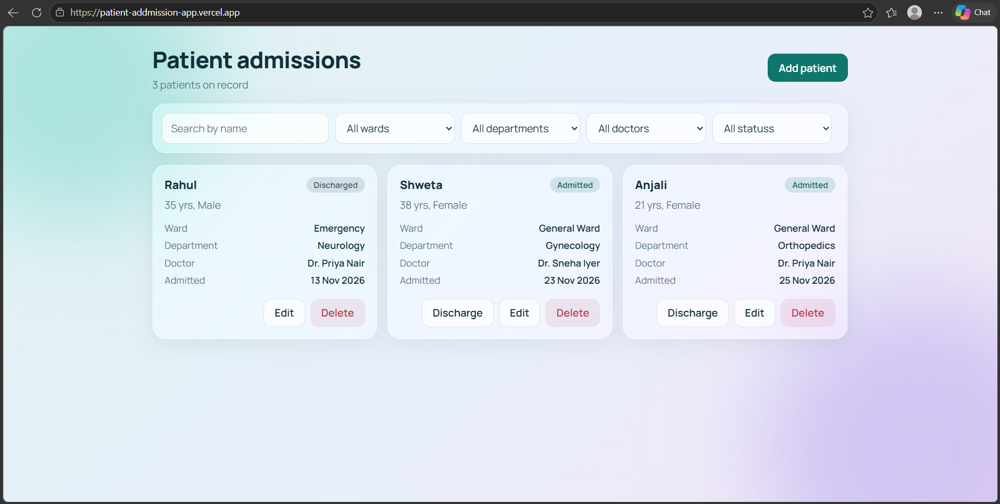
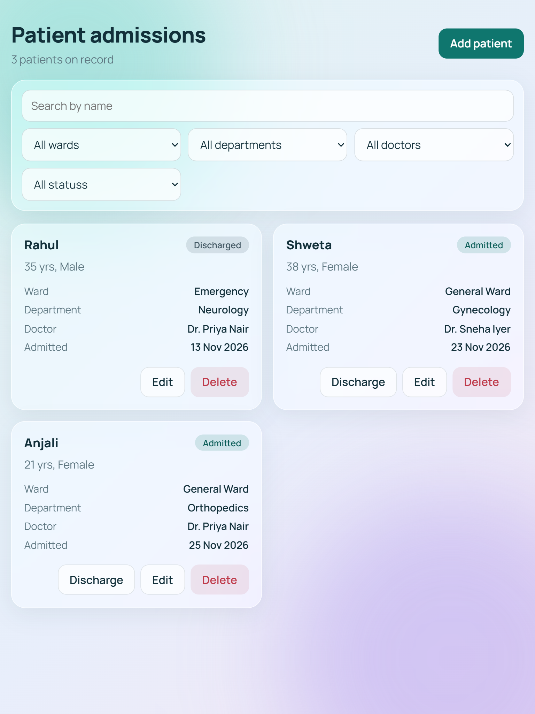
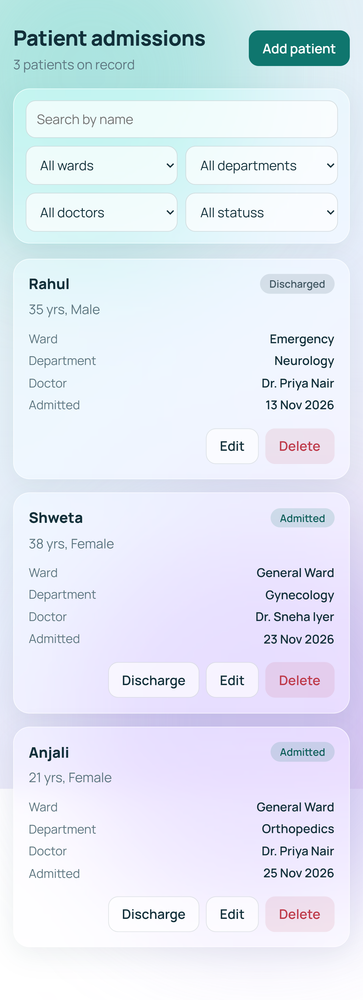
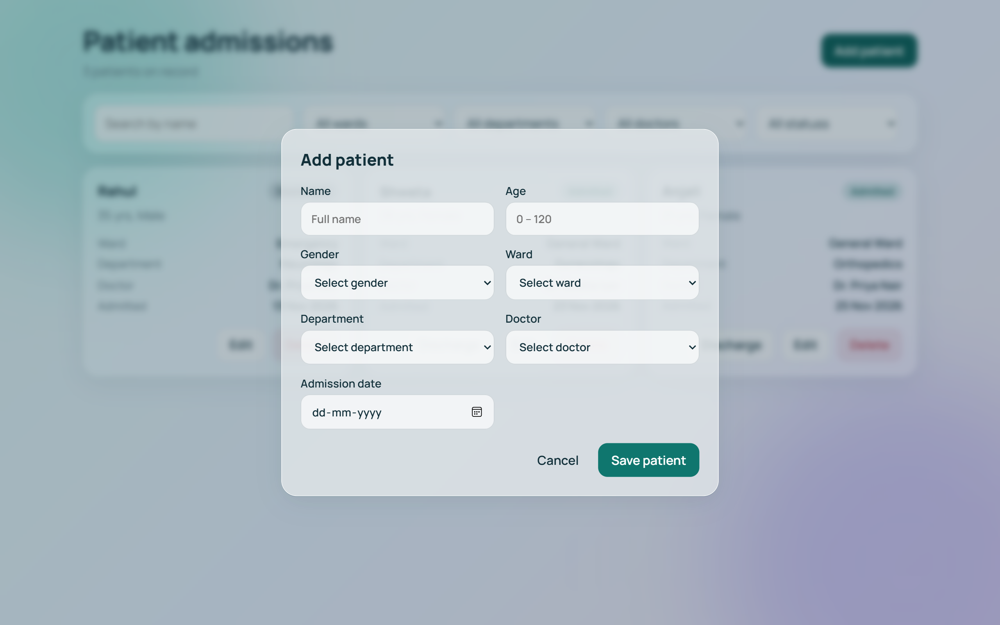
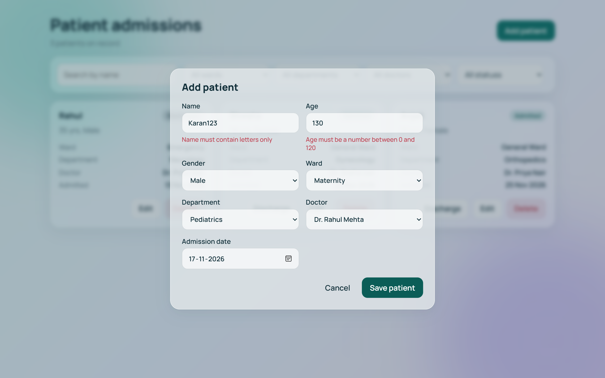
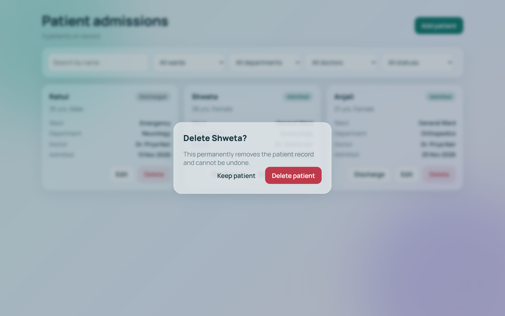

# Patient Admission Management App

Hospital staff can add, view, search, filter, edit, discharge and delete admitted patients.

**Live app:** https://patient-addmission-app.vercel.app/
**Backend API:** https://patient-api-e1gt.onrender.com/api/patients

## Tech stack
- Frontend: React 18 + Vite (plain CSS, glassmorphism UI)
- Backend: Java 17, Spring Boot 3 (REST, Spring Data JPA)
- Database: PostgreSQL in production (H2 file DB for local runs). Data persists across restarts.
- Hosting: Vercel (frontend), Render (backend, Docker), Neon (PostgreSQL)

## Run locally
Backend (needs JDK 17 and Maven):
```bash
cd backend
mvn spring-boot:run        # http://localhost:8080
```
Frontend (needs Node 18+):
```bash
cd frontend
cp .env.example .env       # VITE_API_URL=http://localhost:8080
npm install
npm run dev                # http://localhost:5173
```

## API
| Method | Path | Purpose |
|---|---|---|
| GET | /api/options | Dropdown lists |
| GET | /api/patients?search=&ward=&department=&doctor=&status= | List / search / filter |
| POST | /api/patients | Add |
| PUT | /api/patients/{id} | Edit |
| PATCH | /api/patients/{id}/discharge | Mark discharged |
| DELETE | /api/patients/{id} | Delete |

## Validation (frontend and backend)
Name: required, letters only. Age: required, 0 to 120. Gender, Ward, Department, Doctor: required, must be from the list.
Admission date: required, not in the future. The backend returns HTTP 400 with `{ "message": "...", "errors": { "field": "reason" } }`.

## Environment variables
Backend: `SPRING_DATASOURCE_URL`, `SPRING_DATASOURCE_USERNAME`, `SPRING_DATASOURCE_PASSWORD`, `CORS_ORIGINS`.
Frontend: `VITE_API_URL`. No secrets are committed.

## Screenshots
### Desktop


### Tablet and mobile
<p>
  
  
</p>

### Add patient and validation
<p>
  
  
</p>

### Delete confirmation

